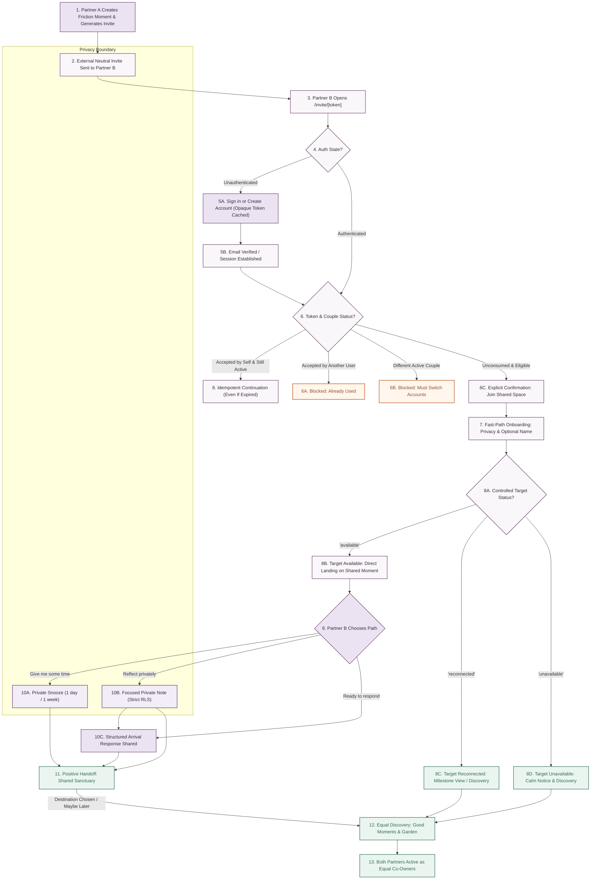

# Purple Garden — Second-Partner Invitation & Activation Journey
## Complete Product Architecture & Customer-Experience Specification

- **Document Version:** 2.3.0
- **Target Branch:** `feature/next-development`
- **Scope:** Customer experience, interface architecture, privacy boundaries, database contracts, bearer-link security, couple row locking, active membership definitions, and state transitions for the invited partner (Partner B).
- **Status:** Approved product architecture; awaiting Supabase database rebuild & developer reconciliation.
- **Audience:** Product Engineering, Design, Security Audit.

---

## 1. Product Objective & Emotional Philosophy

### 1.1 Wholesome, Low-Pressure, and Privacy-First
When Partner A invites Partner B into Purple Garden to address or revisit a moment between them, the experience for Partner B is fraught with psychological vulnerability. If Partner B encounters an accusatory tone, a rigid compliance flow, or immediate exposure to unmoderated friction, the invitation triggers defensiveness, anxiety, and disengagement.

Purple Garden rejects the paradigms of conflict scorekeeping, dispute arbitration, and clinical therapy. It is a quiet, shared sanctuary designed to support mutual softening, everyday shared joy, and private contemplation.

```
       ┌────────────────────────────────────────────────────────┐
       │                 EMOTIONAL NORTH STAR                   │
       │                                                        │
       │  "You have a choice."                                  │
       │  "You can take your time."                             │
       │  "Your perspective belongs here too."                  │
       │  "Private reflection stays private."                   │
       │  "Purple Garden is also for good moments."             │
       │  "This shared space belongs equally to both of you."   │
       └────────────────────────────────────────────────────────┘
```

### 1.2 Approved Core Principles
1. **Never Summoned into a Complaint:** The invitation must never read like a subpoena, an accusation, or a notification of pending disciplinary action.
2. **Never Blamed or Pre-judged:** The product never assigns fault, never labels one partner "at fault", and never demands an apology as an entry toll.
3. **No False Urgency or Countdowns:** Invitation validity is a calm seven days. No countdown timers, no expiring response clocks, and no urgency notifications.
4. **Never Blocked by Heavy Setup:** Partner B is not subjected to a multi-step demographic questionnaire, traits survey, or relationship history before receiving value.
5. **Never Disempowered:** Partner B immediately discovers that they possess identical rights to initiate Good moments, record private notes, and tend the Shared Garden.
6. **Never Subordinate:** Partner B is not a guest in Partner A's space; Partner B is an equal co-owner of the couple's shared rhythm.
7. **Graceful Degradation:** If a target moment is completed, deleted, private, or unavailable, Partner B still successfully joins the valid couple space, receives `target_event_id = null`, and lands on a warm, positive discovery experience.

---

## 2. Existing Implementation Inventory

A granular audit of the `relationship-prototype` codebase reveals existing capabilities, adaptation requirements, and gaps that must be reconciled once the new database is provisioned.

### 2.1 Reusable Capabilities
* **Core Design Tokens & UI Primitives ([src/components/couply-tokens.ts](file:///home/kaivlya/projects/relationship-prototype/src/components/couply-tokens.ts), [src/components/CouplyUI.tsx](file:///home/kaivlya/projects/relationship-prototype/src/components/CouplyUI.tsx)):**
  - Theme-adaptive palette (Lilac Morning, Violet Garden, Plum Evening).
  - Standardized primitives: `CouplyPage`, `CouplyHeader`, `CouplySectionCard`, `CouplyPrimaryButton`, `CouplyQuietButton`, `CouplyChoiceCard`, and `CouplyStatusPill`.
* **Private Reflection Architecture:**
  - `event_private_reflections` table with user-isolated Row-Level Security (`user_id = auth.uid()`).
  - Partner A's reflections are completely inaccessible to Partner B, and vice versa.
* **Three-Pillar Rhythm Model:**
  - `friction`: Reconnection rhythm with attention states (`open`, `opened`, `snoozed`, `reconnected`).
  - `good`: Shared gratitude and everyday joy (blooms flowers directly in Shared Garden).
  - `important_date`: Future milestones and intentional reminders.
* **Database Attention & Activity System:**
  - `relationship_event_attention_states` tracking per-user snoozes (`snoozed_until`).
  - `home_activity_receipts` tracking per-user activity acknowledgement (`activity_key`).

### 2.2 Reusable with Adaptation
* **User Identity Context ([src/context/UserIdentityContext.tsx](file:///home/kaivlya/projects/relationship-prototype/src/context/UserIdentityContext.tsx)):**
  - *Current State:* Reads single `couple_members` row, profile display name, and couple ID.
  - *Adaptation:* Must preserve return intent using strictly allowlisted internal routes (`/invite/[token]` only). Server-authorized token resolution determines the final destination.
* **Event Detail Screen ([src/app/event/[id].tsx](file:///home/kaivlya/projects/relationship-prototype/src/app/event/[id].tsx)):**
  - *Current State:* Displays event history, repair button, and reflection editor.
  - *Adaptation:* Must be elevated to an intentional, deep-linkable landing route (`/invite/[token]`). On first arrival, it must display the Three-Choice Emotional Stance triage layer rather than raw historical notes.

### 2.3 Critical Gaps to Implement
* **Standardized 64-Character Token Invitation Route (`/invite/[token]`):** Single-purpose URL handler presenting raw token to server for server-side SHA-256 digest resolution before displaying couple context.
* **Secure Session Intent Persistence Store:** Client-side storage (`AsyncStorage` / `localStorage`) preserving **only the opaque 64-character invitation token**. Partner names and event content must never be stored on the client.
* **Invited-User Minimal Onboarding Fast-Path:** Bypass 3-step setup in favor of a single lightweight screen asking only for an optional preferred display name, leaving `profiles.display_name` `NULL` if omitted.
* **First-Visit Emotional Stance Layer:** Pre-repair triage interface with 3 non-confrontational choices: "Give me some time" (Snooze), "Reflect privately" (Private Note), and "I'm ready to respond" (Arrival Response).
* **Positive Handoff Milestone:** Emotional bridge screen between initial response and daily connection, routing toward shared joy, garden tending, and equal partnership.
* **Per-User/Per-Couple Experience State Table (`couple_user_experience_states`):** Granular tracking for positive handoff completion, preventing global profile flag leakage.

### 2.4 Architecture Alignment Matrix

| Capability | Frontend-Only | Database Dependent | Post-Migration Phase | Deferred Beyond MVP |
| :--- | :---: | :---: | :---: | :---: |
| Opaque token intent caching in AsyncStorage | Yes | No | Phase 1 | No |
| Single-screen minimal onboarding UI | Yes | No | Phase 2 | No |
| Pre-repair 3-choice moment screen layer | Yes | No | Phase 3 | No |
| Positive handoff visual card | Yes | No | Phase 4 | No |
| Equal-partner action buttons on Home/Events | Yes | No | Phase 4 | No |
| Standardized token hashing (`token_hash`) in DB | No | Yes (`couple_invites`) | Phase 1 | No |
| Optional couple-scoped `target_event_id` | No | Yes (`couple_invites`) | Phase 1 | No |
| Per-user/per-couple handoff completion state | No | Yes (`couple_user_experience_states`) | Phase 4 | No |
| SMS / Push dispatch integration | No | Yes | Deferred | Yes |
| Third-party authentication providers | No | Yes | Deferred | Yes |

---

## 3. The Complete Second-Partner Journey

### 3.1 End-to-End State Machine Flow

The complete 13-stage journey guides Partner B from external invitation to equal co-ownership:



### 3.2 Stage Walkthrough
1. **Moment Creation & Server-Side Token Generation:** Partner A records a friction moment (`relationship_events.event_type = 'friction'`, `visibility = 'ours'`) or initiates a general couple invitation without a target event (`target_event_id = null`). Good moments celebrate shared joy and do not enter the repair invitation or choice triage flow. The server RPC (`create_couple_invite`) generates 32 cryptographically random bytes (256-bit entropy), encodes them as exactly 64 lowercase hexadecimal characters matching `^[0-9a-f]{64}$`, computes the SHA-256 digest, stores `token_hash` in `couple_invites` with a 7-day TTL (`expires_at = now() + interval '7 days'`), and returns the raw token to the inviter exactly once.
2. **External Delivery:** Partner A shares the invitation URL via personal messaging (SMS, WhatsApp, Signal, etc.).
3. **Invitation Landing:** Partner B opens `/invite/[token]`. The screen displays a calm, neutral message without exposing private event text.
4. **Authentication Check:** System checks whether Partner B has an active session.
5. **Intent-Preserving Authentication:** If unauthenticated, Partner B registers or signs in. **Only the raw opaque 64-character token string** is preserved in client storage. Partner names and event details are never cached on the client.
6. **Token Consumption & Idempotency Evaluation:**
   - *Already accepted by current user & still active member:* Returns idempotent success (`already_same_couple`), continuing directly into the shared space **even if the 7-day expiry has passed**.
   - *Already accepted by another user:* Returns controlled status `invite_already_used`.
   - *Unconsumed, not revoked, and not expired:* Evaluates couple membership. If caller belongs to another active couple, blocks join (`different_active_couple`); otherwise presents explicit join confirmation.
7. **Fast-Path Onboarding Gate:** Partner B is presented with privacy guarantees, an optional preferred display name, and an explicit action to join. If omitted, `profiles.display_name` remains `NULL` in the database, and the presentation fallback is `"your partner"` in prose and `"Partner"` in UI labels. Name is **never** derived from an email address. On completion, `profiles.onboarding_completed` is set to `true`.
8. **Target Moment Resolution (Controlled Server Contract):**
   - `'available'`: Target event is open, shared friction. Routes to `/event/[id]` (`target_available` $\to$ `first_moment_choice_layer`).
   - `'reconnected'`: Target event has been reconnected/settled. Routes to `/event/[id]?status=completed` (`target_reconnected` $\to$ `positive_discovery`).
   - `'unavailable'`: (Encompasses deleted, private, foreign, or missing targets). Couple join remains successful; returns `target_event_id = null`, and routes to `positive_discovery` with a calm, non-speculative explanation (`target_unavailable` $\to$ `positive_discovery`).
9. **Three-Choice Moment Layer:** On first visit to an open moment, Partner B selects their desired emotional stance.
10. **Action Execution:**
    - *Path A (Give me some time):* Sets private snooze; no notification sent to Partner A; returns to Home.
    - *Path B (Reflect privately):* Opens private editor; saves strictly to `event_private_reflections`; note remains 100% invisible to Partner A.
    - *Path C (Ready to respond):* Selects arrival code (`heard`, `need_time`, `suggest_next_step`) and confirms explicit sharing.
11. **Positive Handoff:** Grounding screen explaining that Purple Garden is built for shared joy. **Completed only through explicit destination selection or "Maybe later".** Render-only leaves handoff uncompleted. Completion is tracked per user per couple in `couple_user_experience_states`.
12. **Equal Discovery:** Partner B is introduced to the Shared Garden, Our Space, and the "Something good" moment creator.
13. **Equal Co-Ownership:** Both partners experience identical navigation, visibility, and creation rights.

---

## 4. Invitation Experience, Bearer Security & Concurrency Model

### 4.1 External Invitation Copy
External invitations never contain category tags, intensity scores, shared wording, or private notes:

> **External Invite Message:**<br/>
> *"Alex has invited you to Purple Garden.*<br/>
> *They would like to return to a shared moment with you. You can open it whenever you feel ready.*<br/>
> *[https://purplegarden.app/invite/4a8f9b2c3d4e5f60718293a4b5c6d7e8f90123456789abcdef0123456789abcdef]*"

### 4.2 Standardized Token Encoding & Bearer-Link Security Architecture
In the MVP architecture, the invitation URL is a **bearer link**. Anyone who possesses the link can present it to join the couple space. To mitigate risks without creating high-friction signup barriers, the system enforces the following security controls:

* **Cryptographic Entropy & Standardized Encoding:**
  - Token is generated from **32 cryptographically secure random bytes** (`extensions.gen_random_bytes(32)`).
  - Encoded as **lowercase hexadecimal**.
  - Exactly **64 characters** in length matching regex `^[0-9a-f]{64}$`.
  - Exactly **256 bits of entropy**.
  - URL-safe string representation for path segments (`/invite/[token]`).
* **Storage Invariant:** The database **never stores or logs raw tokens**. Only the SHA-256 digest (`token_hash := extensions.digest(raw_token, 'sha256')`) is persisted in `public.couple_invites`.
* **Acceptance Invariant:** Acceptance requires presenting the exact 64-character raw string. The server hashes the presented string using schema-qualified `extensions.digest` with an empty `search_path` and compares the resulting digest to `token_hash`.
* **Target Event Type Boundary (Friction-Only):**
  - Target moments for this repair journey are strictly restricted to `relationship_events.event_type = 'friction'` with `visibility = 'ours'` belonging to the invitation's couple.
  - Good moments (established database value: `event_type = 'positive'`) celebrate shared joy and do not enter the repair invitation or triage choice layer.
  - General invitations (without a specific moment) set `target_event_id = null` and route directly to `positive_discovery` upon acceptance.
* **HTTPS Transport Exclusivity:** All endpoints strictly require TLS 1.3 / HTTPS. HSTS headers prevent protocol downgrade attacks.
* **Seven-Day Bounded Expiry:** Hard expiration (`expires_at = created_at + interval '7 days'`) without urgency countdowns.
* **Strict Single-Use Invariant:** Once accepted (`accepted_at IS NOT NULL`), the token is permanently consumed and cannot be reused by any other account.
* **Revocability & Regeneration:** The inviter can revoke or regenerate an active invitation at any time. Generating a fresh invitation revokes only pending unconsumed invitations (`accepted_at IS NULL AND revoked_at IS NULL`).
* **Explicit Join Confirmation:** Visiting or opening a link **never silently joins a couple**. The user must be authenticated, review privacy boundaries, and tap an explicit "Continue to the shared moment" action.
* **Zero Pre-Authentication Content Exposure:** The landing page displays only generic invitation copy. Event text, category, intensity, and partner notes are never returned before authentication and verified couple membership.
* **URL Sanitization & Scrubbing:** After safe ingestion by the client application, the token parameter is stripped from the visible browser URL (via `window.history.replaceState` or immediate router navigation to clean internal routes).
* **Telemetry & Referrer Privacy:** Invitation tokens are strictly scrubbed from analytics events, performance logs, error telemetry, and outbound HTTP `Referer` headers (`Referrer-Policy: no-referrer`).
* **Third-Party Script Isolation:** The token-bearing landing page contains zero third-party tracking scripts, iframes, or unmanaged external assets that could intercept the URL.
* **Recipient Identity Binding Clarification:** Because the MVP does not require Partner A to know or input Partner B’s email address, the system cannot bind the token to a pre-known human identity. Therefore, `"wrong_account"` is a user-controlled recovery choice: the user is shown their current account identity and offered an explicit sign-out/sign-in flow. Automatic membership reassignment is strictly blocked.

### 4.3 Couple Row Locking & Concurrency Invariants
To prevent race conditions, membership overcapacity, and duplicate rows, acceptance locks the parent `public.couples` row `FOR UPDATE`:
1. **Two different users accept the same invitation simultaneously:** Both transactions hash the token and attempt to lock the same `couple_invites` row `FOR UPDATE`. The first transaction acquires the lock, validates `accepted_at IS NULL`, inserts membership, and sets `accepted_at = now()`. The second transaction unblocks, discovers `accepted_at IS NOT NULL` where `accepted_by != auth.uid()`, and immediately returns `invite_already_used`.
2. **Two active invitations for the same couple accepted simultaneously:** Both transactions lock their respective invitation rows, then attempt to lock the shared `public.couples` row `FOR UPDATE`. The second transaction waits. When the first transaction commits, the second acquires the lock, inspects active memberships, sees 2 active members, and rejects with capacity limit reached (`'Relationship space full'`).
3. **Same user double-submits acceptance:** First transaction commits membership and sets `accepted_by = auth.uid()`. Second transaction unblocks, sees `accepted_by = auth.uid()`, and returns idempotent success (`already_same_couple`).
4. **Capacity Invariant:** Couple capacity remains strictly limited to two active members at all times.

### 4.4 Comprehensive Invitation State Matrix

| State | Condition | User-Facing Copy | Available Actions | Data / Security Invariant |
| :--- | :--- | :--- | :--- | :--- |
| **Valid** | Token active, couple open, `expires_at > now()` | "Alex invited you to connect in Purple Garden." | `Accept & Continue`, `Maybe later` | No event content returned until user signs in & accepts. |
| **already_same_couple** | Caller previously accepted this invite or is active member | "You are already connected with Alex." | `Go to your shared space` | Idempotent acceptance; routes directly even if 7-day expiry passed. |
| **different_active_couple** | Caller belongs to a different active couple | "You already belong to another relationship space. Each person can belong to one space at a time." | `Switch accounts`, `Go to my space` | Blocks acceptance. Never transfers membership automatically. |
| **wrong_account** | Signed in as user not intended for invite | "You are currently signed in as [Name]. To connect with Alex, please switch accounts." | `Sign out and switch accounts`, `Keep current session` | Offers clean sign-out/sign-in; prevents cross-couple leaks. |
| **invite_already_used** | Single-use token accepted by another user account | "This invitation has already been accepted." | `Sign in with another account`, `Contact support` | Single-use invariant; fails closed. |
| **invite_expired** | Unconsumed token exceeded 7-day TTL (`expires_at <= now()`) | "This invitation has expired. Ask Alex to share a fresh invitation whenever you are ready." | `Return home`, `Sign in` | No countdown or false urgency language displayed. |
| **invite_revoked** | Unconsumed invite revoked by Partner A (`revoked_at IS NOT NULL`) | "This invitation is no longer active." | `Return to main page` | Zero metadata leaked regarding revocation reason. |
| **invitation_regenerated**| Unconsumed invite superseded by replacement invite | "A newer invitation has been shared by your partner. Please use the latest link from Alex." | `Return to main page` | Superseded tokens reject gracefully. |
| **invite_invalid** | Token string invalid format or not found in `couple_invites` | "This invitation link is invalid or unavailable." | `Return to main page` | Fails closed; prevents token enumeration. |
| **target_available** | Target event is open, shared friction belonging to couple | "Alex shared a moment with you." | `Open moment choice`, `Explore shared space` | Server returns `'available'`. `target_event_id` returned. Routes to `first_moment_choice_layer`. |
| **target_reconnected** | Target event was reconnected/settled before acceptance | "Alex invited you to connect. This moment has already been gently set down, and your shared space is ready." | `Explore your shared space` | Server returns `'reconnected'`. `target_event_id` returned with status. Routes to `positive_discovery`. |
| **target_unavailable** | Target event is missing, deleted, private, or foreign | "Alex invited you to connect. Your shared space is ready for both of you." | `Explore your shared space` | Server returns `'unavailable'` with `target_event_id = null`. Join succeeds; routes to `positive_discovery`. Calm copy; zero speculation on reason. |
| **positive_discovery** | Welcoming post-join discovery state | "Welcome to your shared space. Here are quiet ways to tend what matters between you." | `See your Shared Garden`, `Share something good`, `Visit Our Space` | Immediate positive engagement without friction fixation. |
| **positive_handoff_deferred**| User chose "Maybe later" on positive handoff | "Welcome to your shared space." | `Go to Home` | Handoff marked complete for this couple; navigation unblocked. |
| **network_recovery_invite**| Client offline during token check | "Unable to reach Purple Garden right now. Your invitation is safe." | `Retry connection` | Retains opaque token in client storage; retries idempotently. |

---

## 5. Authentication & Return-Intent Preservation

### 5.1 The Intent Preservation Lifecycle
To prevent session fragmentation without compromising security:

```
External Link: /invite/[64-char-token]
      │
      ▼
Client checks session:
  ├─ Session active ───► Call accept RPC with raw token ──► Server hashes & verifies ──► Routes user
  └─ Session null   ───► Write intent to storage:
                            {
                              token: "4a8f9b2c3d4e5f60718293a4b5c6d7e8f90123456789abcdef0123456789abcdef"
                            }
                        Navigate to allowlisted route: /?mode=sign_up&intent=invite
                              │
                              ▼
                        User Signs Up / Signs In
                              │
                              ▼
                        Auth Redirect strictly to allowlisted internal route: /invite/[64-char-token]
                              │
                              ▼
                        Server-authorized resolution:
                        RPC computes digest ──► Checks token_hash ──► Validates ──► Returns route
```

### 5.2 Storage Contract
* **Key:** `@purple_garden_pending_invite`
* **Payload Structure:**
  ```typescript
  interface PendingInviteIntent {
    token: string; // Opaque 64-character lowercase hexadecimal token string ONLY
  }
  ```
* **Strict Security Rules:**
  - **No Partner Names:** Partner names must **never** be cached in `localStorage` or `AsyncStorage`.
  - **No Event Content:** Event titles, IDs, notes, or categories must **never** be stored client-side.
  - **Allowlisted Return Routes:** Authentication redirection is strictly restricted to allowlisted internal paths (`/invite/[token]` only). Open redirects are blocked.
  - **Server-Determined Destination:** The client never chooses its final route based on cached parameters; the server RPC dictates whether to navigate to `/event/[id]` or `positive_discovery`.

---

## 6. Invitation-Specific Minimal Onboarding, Display Name & Atomicity Contract

### 6.1 Contrast: Default vs Invited Onboarding

| Feature | Standard Signup ([src/app/onboarding.tsx](file:///home/kaivlya/projects/relationship-prototype/src/app/onboarding.tsx)) | Invited Partner Signup (Fast-Path) |
| :--- | :--- | :--- |
| **Step Count** | 3 progressive screens | 1 single-purpose screen |
| **Display Name** | Required in Step 1 | **Optional** (leaves `profiles.display_name` NULL if omitted) |
| **Persisted Fallback Name** | N/A | **Never writes "Partner" to database** |
| **Email Name Extraction** | Prohibited | **Strictly prohibited** (never derives name from email) |
| **Birthday (Month/Day)** | Asked in Step 2 | **Skipped** (completed later in Settings) |
| **Introduction Note** | Asked in Step 2 | **Skipped** |
| **Support Preferences** | Asked in Step 2 | **Skipped** |
| **Personality Traits** | Multi-select chips in Step 2 | **Skipped** |
| **Interests Chips** | Multi-select chips in Step 2 | **Skipped** |
| **Privacy Explanations** | Full summary in Step 3 | **Integrated inline with joining choice** |
| **Time to First Value** | $\sim 3\text{--}5$ minutes | **$< 30$ seconds** |

### 6.2 The Invited-User Onboarding Gate & Lifecycle
Invitation acceptance alone **never occurs simply by opening or viewing the invitation link**.

The invited-user fast-path onboarding gate requires all of the following:
1. **Authenticated User:** Active authenticated session (`auth.uid()`).
2. **Valid Invitation:** 64-character lowercase hexadecimal token matching `^[0-9a-f]{64}$`.
3. **Explicit Confirmation to Join:** User explicitly taps the confirmation action to join Partner A's space.
4. **Presentation of Privacy & Sharing Boundaries:** Clear inline explanation that private reflections stay private and neither partner is judged.
5. **Optional Preferred Name:** User may enter a preferred display name, or leave it blank.
6. **Explicit "Continue to the shared moment" Action:** The user intentionally commits to entering the couple space.

#### On Successful Completion:
- Insert or confirm couple membership in `public.couple_members`.
- Store preferred name in `profiles.display_name` **only if explicitly supplied and non-blank** (trimmed, $\le 40$ chars). If omitted or blank, leave `profiles.display_name` as `NULL`. **Never write "Partner" to the database.**
- Leave all optional profile fields (`birthday`, `introduction_note`, `support_preferences`, `personality_traits`, `interests`) null or empty.
- Set `profiles.onboarding_completed = true`.
- Synchronize `UserIdentityContext` so the client application recognizes the user as onboarded and permits unblocked navigation.
- Route according to server-authorized target status (`target_available` $\to$ `/event/[id]`, `target_reconnected` $\to$ `/event/[id]?status=completed`, `target_unavailable` $\to$ `/home?notice=moment_unavailable`).

#### Strict Exclusion Rules — `onboarding_completed` is NEVER set when:
- The invitation landing page merely renders or is viewed.
- The user selects "Maybe later" or "Not now".
- Authentication is abandoned or incomplete.
- Join acceptance fails validation (e.g. `different_active_couple`, `couple_full`, `invite_revoked`, `invite_expired`).
- The network transaction errors or drops before commit.

#### Non-Invited Signup & Deferred Field Accessibility:
- Normal non-invited user signup retains the full three-step onboarding flow in [src/app/onboarding.tsx](file:///home/kaivlya/projects/relationship-prototype/src/app/onboarding.tsx).
- All deferred profile fields remain completely accessible at any time through:
  **Settings → Profile** ([src/app/profile.tsx](file:///home/kaivlya/projects/relationship-prototype/src/app/profile.tsx)).

### 6.3 Atomicity and Recovery Model
To eliminate orphaned states between couple membership and onboarding completion, the architecture evaluates two implementation models:

* **Model A: Single Validated Atomic RPC (Recommended MVP):**
  A single fast-path completion RPC (`accept_couple_invite_by_token`) atomically:
  1. Validates format and hashes the 64-character raw token.
  2. Locks the invitation row and parent couple row `FOR UPDATE`.
  3. Verifies capacity and inserts couple membership into `couple_members`.
  4. Marks the invitation accepted (`accepted_at = now()`, `accepted_by = auth.uid()`).
  5. Updates `profiles.display_name` if supplied, or leaves it `NULL`.
  6. Sets `profiles.onboarding_completed = true`.
  7. Evaluates target event status (`available`, `reconnected`, `unavailable`).
  8. Commits all state changes in a single database transaction.

  *Benefit:* Guarantees that an accepted member can never be trapped in a half-onboarded state where membership exists but `onboarding_completed = false` triggers navigation loops.

* **Model B: Two Idempotent Steps (Fallback / Decoupled Schema):**
  If the developer's rebuilt schema strictly decouples couple membership from profile mutation:
  - **Step 1:** `accept_couple_invite_by_token(p_invite_token)` — locks rows, verifies capacity, inserts membership, and updates `accepted_at`.
  - **Step 2:** `complete_invited_onboarding(p_preferred_name)` — updates display name if provided and sets `profiles.onboarding_completed = true`.
  - **Idempotency & Recovery Guarantee:** Both operations must be individually idempotent. If Step 2 fails due to a network drop, subsequent app launch recognizes the user as an active couple member via `already_same_couple` idempotency, resumes at onboarding completion, and finalizes `profiles.onboarding_completed = true` without creating duplicate membership records or throwing duplicate key errors.

### 6.4 Display Name Persistence vs Presentation Fallback
* **Persisted Identity:** If `p_preferred_name` is null or blank, `profiles.display_name` is left `NULL`. The system **never** persists `"Partner"` to the database. If a preferred name is entered, it is trimmed, sanitized, and stored up to 40 characters.
* **Presentation Fallback:**
  - **In Prose / Sentences:** `"your partner"` (*"Shared with your partner"* / *"You and your partner"*).
  - **In UI Labels / Badges:** `"Partner"`.
* **Email Handle Inference:** **Strictly forbidden.** The system never inspects the user's email address to infer a name.

---

## 7. First Shared-Moment Experience

When Partner B lands on `/event/[id]`, they encounter an emotionally regulated presentation:

```
┌──────────────────────────────────────────────────────────┐
│  ‹ Back to Our Space                                     │
│                                                          │
│  SHARED WITH YOU                                         │
│  Alex shared a moment with you                           │
│                                                          │
│  "You do not need to answer immediately. Choose what     │
│   feels right for you now."                              │
│                                                          │
│  ┌────────────────────────────────────────────────────┐  │
│  │ 🌿 What Alex Shared                                │  │
│  │ Category: Communication                            │  │
│  │ Topic: "Feeling disconnected during evening routines"│
│  │ Recorded: Today at 18:30                           │  │
│  └────────────────────────────────────────────────────┘  │
│                                                          │
│  🔒 Alex's private thoughts and notes remain private.    │
│  🔒 Anything you write privately stays private to you.   │
│                                                          │
│  How would you like to meet this moment?                 │
│                                                          │
│  ┌────────────────────────────────────────────────────┐  │
│  │ ⏳ Give me some time                               │  │
│  │    Take breathing room. Snooze private reminders.  │  │
│  └────────────────────────────────────────────────────┘  │
│  ┌────────────────────────────────────────────────────┐  │
│  │ 📝 Reflect privately                               │  │
│  │    Write down your thoughts. Visible only to you.  │  │
│  └────────────────────────────────────────────────────┘  │
│  ┌────────────────────────────────────────────────────┐  │
│  │ 🤍 I’m ready to respond                            │  │
│  │    Acknowledge or suggest a gentle next step.      │  │
│  └────────────────────────────────────────────────────┘  │
└──────────────────────────────────────────────────────────┘
```

---

## 8. Branch A: "Give Me Some Time"

* **Modal / Sheet Heading:** "Give this moment some room"
* **Supporting Body:** "Taking time to process is healthy. This choice is private. The moment will stay in Our Space, and you can return whenever you want."
* **Options:**
  - `Not today (24 hours)` $\longrightarrow$ Sets `snoozed_until = now() + interval '24 hours'`.
  - `Give it a week (7 days)` $\longrightarrow$ Sets `snoozed_until = now() + interval '7 days'`.
  - `I'll return when ready` $\longrightarrow$ Indefinite snooze (`snoozed_until = 'infinity'`).
* **Privacy Isolation:** No notification or activity alert is sent to Partner A. Partner A continues to see the peaceful waiting state: *"Alex shared a moment with you · Shared today at 18:30"*.
* **Home Return State:** The Home tile returns to a calm empty state: *"Nothing needs your attention right now."*

---

## 9. Branch B: "Reflect Privately"

* **Screen Heading:** "Your Private Notes"
* **Supporting Body:** "Write down your private feelings, what you heard, or what you might want to explore. This note is completely private to you. Partner A cannot see it."
* **Data Flow:** Saves exclusively to `event_private_reflections` using `user_id = auth.uid()`.
* **Post-Reflection Actions:**
  - `Save & keep private` $\longrightarrow$ Transitions to Positive Handoff or Home.
  - `I feel ready to share a response now` $\longrightarrow$ Transitions smoothly to Branch C.

---

## 10. Branch C: "I'm Ready to Respond"

* **Screen Heading:** "Respond to Alex"
* **Supporting Body:** "Choose how you'd like to acknowledge what Alex shared. Keeping it simple helps conversations breathe."
* **Emotional Arrival Codes:**
  - `I hear you`: *"I've read what you shared, and I'm listening."*
  - `I need some time to process`: *"Thank you for sharing this. I need a little space before we talk."*
  - `Let's talk about this`: *"I'd like to find a quiet time for us to talk."*
* **Optional Short Note:** Freeform text input ($\le 280$ characters) for gentle nuance.
* **Explicit Sharing Confirmation:** A clear toggle: `[✓] Share this response with Alex`.
* **Database Execution:** Submits to `repair_responses` with `visibility = 'ours'`.

---

## 11. The Positive Handoff Experience

```
┌──────────────────────────────────────────────────────────┐
│  ✨ Your response has a place here now                   │
│                                                          │
│  Purple Garden is also for the good things you create    │
│  together. You don't have to wait for things to feel     │
│  heavy to come here.                                     │
│                                                          │
│  Quiet ways to tend what matters between you:            │
│                                                          │
│  ┌────────────────────────────────────────────────────┐  │
│  │ 🌸 See your Shared Garden                          │  │
│  │    Where your everyday care takes shape.           │  │
│  └────────────────────────────────────────────────────┘  │
│  ┌────────────────────────────────────────────────────┐  │
│  │ ✨ Share something good                            │  │
│  │    A small thank you, a favorite memory, or joy.   │  │
│  └────────────────────────────────────────────────────┘  │
│  ┌────────────────────────────────────────────────────┐  │
│  │ 🌿 Visit Our Space                                 │  │
│  │    The rhythm of moments you share together.       │  │
│  └────────────────────────────────────────────────────┘  │
│                                                          │
│  [ Maybe later ]                                         │
└──────────────────────────────────────────────────────────┘
```

* **Completion Invariant:** **Requires explicit destination choice or "Maybe later".** Merely rendering or backing out leaves the state uncompleted.
* **Per-User/Per-Couple Storage:** Stored in `couple_user_experience_states` table (`positive_handoff_completed_at`). Never stored as a global user profile flag.

---

## 12. Positive Discovery & Ongoing Equal Participation

If the target moment was already completed, deleted, made private, foreign, or missing:
1. **Calm Orientation:** *"Alex invited you to connect. Your shared space is ready for both of you."*
2. **Immediate Equal Agency:** Direct primary action buttons to:
   - Create a Good moment (`+ Something good`).
   - View the Shared Garden (`🌸 Our Garden`).
   - Explore shared lists and important dates (`🌿 Our Space`).
3. **No Secondary Status:** Partner B is never marked with a "Guest" or "Invited" badge.

---

## 13. What Matters Now & Home Surface Alignment

1. **Home Candidate Priority:**
   - Priority 1: Unopened partner repair response.
   - Priority 2: Unopened partner shared friction.
   - Priority 3: Shared-list activity within 24 hours.
   - Priority 4: Partner Good moment within 24 hours.
   - Priority 5: Resurfaced unresolved friction after cooldown.
2. **Seen/Read Lifecycle Invariant:**
   - Opening an item generates a `home_activity_receipts` row for `auth.uid()`.
   - Returning Home permanently excludes seen informational moments for that user without affecting the partner.
   - Calm empty state when no activity is pending.

---

## 14. Comprehensive Edge-Case Matrix

| # | Scenario | User-Facing State | System & Data Behavior | Recovery / Retry Path | Privacy Guarantee |
| :--- | :--- | :--- | :--- | :--- | :--- |
| **1** | **Invitation Expired** | "This invitation has expired." | Unconsumed token where `expires_at <= now()`. | Partner B asks Partner A for a new code. | No event content or partner notes leaked. |
| **2** | **Invitation Revoked** | "This invitation is no longer active." | Unconsumed token where `revoked_at IS NOT NULL`. | Safe return button to landing page. | Reason for revocation is withheld. |
| **3** | **Newer Invite Generated**| "A newer invitation has been shared." | Previous token hash marked revoked/superseded. | Use latest link from partner. | Protects single active invitation per couple. |
| **4** | **Single-Use Token Reused**| "This invitation was already accepted." | `accepted_at IS NOT NULL` and `accepted_by != auth.uid()`. | If accepted by another account, fail closed. | No access to couple rows or partner data. |
| **5** | **Different Active Couple**| "You belong to another relationship space." | Caller exists in `couple_members` for other couple. | Sign out to switch accounts; return to own space. | Automatic transfer strictly blocked. |
| **6** | **Same Couple Idempotency**| "You are already connected." | Caller previously accepted this invite and remains member. | Direct continuation even if 7-day expiry passed. | Zero duplicate membership rows. |
| **7** | **Target Event Completed** | "This moment has already been set down." | Server returns `target_status = 'reconnected'`. | Join succeeds; routes to `positive_discovery`. | Returns `target_event_id` with status. Preserves couple connection gracefully. |
| **8** | **Target Event Unavailable** | "Alex invited you to connect. Your shared space is ready for both of you." | Server returns `target_status = 'unavailable'`. (Applies to deleted, private, foreign, or missing targets). | Join succeeds; routes to `positive_discovery`. | Returns `target_event_id = null`. Calm, neutral copy; zero speculation on reason. |
| **9** | **Non-Friction Target Attempted** | "Alex invited you to connect. Your shared space is ready for both of you." | Moment-specific repair invites target strictly `event_type = 'friction'`. Good moments rejected on creation; if supplied, server returns `target_status = 'unavailable'`. | Join succeeds; routes to `positive_discovery`. | Returns `target_event_id = null`. Repair flow restricted strictly to friction moments. |
| **10**| **Delayed Email Verification**| "Please check your inbox to confirm." | Token cached in storage; return route allowlisted. | Magic link restores session and resumes join. | Opaque token survives redirect cleanly. |
| **11**| **Offline During Join** | "Connection lost. Your invitation is safe." | Client catches network error; retains token. | "Tap to retry" button re-executes RPC. | No corrupted database state. |
| **12**| **Handoff Render-Only Exit**| User exits app without choosing destination. | No completion row written to DB. | Handoff presented again on next return. | Requires explicit choice or "Maybe later". |

---

## 15. Copy & Emotional Safety Catalogue

| Screen / Touchpoint | Element | Production Copy | Emotional Intent |
| :--- | :--- | :--- | :--- |
| **External Invite** | Message Body | *"Alex has invited you to Purple Garden. They would like to return to a shared moment with you. You can open it whenever you feel ready."* | Zero pressure, non-accusatory, respectful agency. |
| **External Invite** | Actions | `Open Purple Garden` · `Maybe later` | Explicit choice to decline or postpone. |
| **Landing** | Title | *"Alex invited you to their shared space"* | Welcoming, calm, clear partnership context. |
| **Fast-Path Setup** | Heading | *"Welcome to your shared space"* | Focus on unity, not administrative friction. |
| **Fast-Path Setup** | Subtitle | *"Choose what you would like to be called. You can complete the rest later."* | Lightweight, low commitment. |
| **Name Fallback (Prose)**| Body | *"Shared with your partner"* | Respectful, non-intrusive. |
| **Name Fallback (Label)**| Label | `"Partner"` | Clean, standardized presentation identifier. |
| **First Moment** | Heading | *"Alex shared a moment with you"* | Factual, neutral, no accusation. |
| **First Moment** | Subtitle | *"You do not need to answer immediately. Choose what feels right for you now."* | De-escalates defensiveness immediately. |
| **Snooze Option** | Card Title | *"Give this moment some room"* | Reframes delay as emotional breathing room. |
| **Positive Discovery**| Heading | *"Welcome to your shared space"* | Warm reorientation when target is unavailable. |
| **Positive Discovery**| Subtitle | *"Your shared space is open. Here are quiet ways to tend what matters between you."* | Focus on forward-looking connection. |
| **Positive Handoff**| Heading | *"Your response has a place here now"* | Dignified acknowledgment of participation. |
| **Positive Handoff**| Body | *"Purple Garden is also for the good things you create together."* | Shifting focus to long-term mutual care. |

---

## 16. Accessibility & Inclusivity Specification

1. **Screen Reader Reading Order:** Overline $\longrightarrow$ Title $\longrightarrow$ Contextual Subtitle $\longrightarrow$ Event Content $\longrightarrow$ Privacy Explanations $\longrightarrow$ Actions.
2. **Explicit Touch Targets:** All interactive controls enforce a minimum bounding box of $44 \times 44\text{ pt}$ (WCAG 2.5.5).
3. **Contrast Compliance:** Text elements satisfy WCAG AA across Lilac Morning, Violet Garden, and Plum Evening.
4. **Focus Restoration (Web):** Modal dialogs (snooze, confirmation sheets) trap focus during presentation and return focus upon dismissal.
5. **No Color-Only State Indicators:** Selected cards combine color shifts with visible borders, checked radio circles (`[●]`), and bold typography.
6. **Reduced Motion:** Replaces slide animations with gentle $150\text{ ms}$ opacity fades under `prefers-reduced-motion`.

---

## 17. Scope: MVP vs Deferred Capabilities

```
┌────────────────────────────────────────────────────────────────────────┐
│                              SCOPE MATRIX                              │
├───────────────────────────────────┬────────────────────────────────────┤
│           INCLUDED IN MVP         │        DEFERRED BEYOND MVP         │
├───────────────────────────────────┼────────────────────────────────────┤
│ • 64-character token_hash invites │ • Automated SMS/Email dispatch     │
│ • Client intent storage (token)   │ • Native push notification service │
│ • Allowlisted internal returns    │ • AI conversation coaching         │
│ • Idempotent same-couple join     │ • "Use private note as draft"      │
│ • Different-couple block          │ • Public forums / community tips   │
│ • Truthful target status handling │ • Relationship gamification/scores │
│ • Minimal display-name onboarding │ • Emergency / therapy hotlines     │
│ • Non-persisted name fallbacks    │ • Smart scheduling calendars       │
│ • 3-choice first-moment arrival   │ • Multi-couple switching           │
│ • Private per-user snooze         │ • Complex recommendation engines   │
│ • Per-user/couple handoff state   │                                    │
│ • Full equal-partner parity       │                                    │
└───────────────────────────────────┴────────────────────────────────────┘
```

---

## 18. File Layout & Component Architecture

```
src/
├── app/
│   ├── index.tsx                         # Modified: inspects session & intent store
│   ├── invite/
│   │   └── [token].tsx                   # NEW: landing route for bearer invitations
│   ├── onboarding.tsx                    # Standard signup flow (retained untouched)
│   ├── event/
│   │   └── [id].tsx                      # Modified: displays 3-choice layer on arrival
│   ├── home.tsx                          # Modified: integrates positive handoff modal
│   └── profile.tsx                       # Profile editor (all deferred fields available)
├── components/
│   ├── CouplyUI.tsx                      # Base design primitives
│   ├── couply-tokens.ts                  # Design tokens & color palettes
│   ├── onboarding/
│   │   └── InvitedUserFastPath.tsx       # NEW: single-screen display name input & gate
│   ├── event/
│   │   ├── FirstVisitChoiceModal.tsx     # NEW: 3-choice triage component
│   │   ├── PrivateSnoozeModal.tsx        # NEW: private snooze selection sheet
│   │   ├── PrivateReflectionEditor.tsx   # NEW: private note composer
│   │   ├── ArrivalResponseModal.tsx      # NEW: response codes & sharing confirmation
│   │   └── PositiveHandoffModal.tsx      # NEW: emotional bridge card
│   └── home/
│       └── PositiveDiscoveryView.tsx     # NEW: positive orientation when target unavailable
├── context/
│   └── UserIdentityContext.tsx           # Modified: manages couple state & return intent
└── lib/
    ├── invite-intent.ts                  # NEW: storage helper for pending token intent
    ├── home-activity.ts                  # Modified: receipt evaluation & priority sorting
    └── use-repair-workflow.ts            # Modified: hooks for arrival choices & snooze
```

---

## 19. Database Contracts & Schema Extension Blueprint

### 19.1 Developer Reconciliation Points & Type Contracts

#### 19.1.1 General Invitations vs Moment Invitations
* **Invitation Purpose Classification:**
  - **General Invitation:** `invite_purpose = 'general'`. Created without a specific target moment (`target_event_id = null`). The server contract **does not pretend a target moment became unavailable**. `target_status` is returned as `null` or `'no_target'`.
  - **Moment Invitation:** `invite_purpose = 'moment'`. Linked to an existing shared friction event (`target_event_id`). The server returns truthful moment statuses: `'available'`, `'reconnected'`, or `'unavailable'`.
* **Client Behavior:** For general invitations, Partner B is welcomed directly into the shared space (`positive_discovery`) without showing any error, cancellation, or unavailable notice.

#### 19.1.2 Token Hash Storage Type Reconciliation
* **Recommended Schema (Bytea):**
  ```sql
  token_hash bytea NOT NULL UNIQUE
  ```
  Compared directly in queries and RPCs against binary digests: `extensions.digest(p_invite_token, 'sha256')`.
* **Alternative Schema (Text):**
  If the developer instead provisions `token_hash text NOT NULL UNIQUE`, both creation and acceptance RPCs must use encoded hexadecimal strings consistently:
  ```sql
  encode(extensions.digest(raw_token, 'sha256'), 'hex')
  ```

#### 19.1.3 Established Positive Event Type Contract
* **Data Model Invariant:** The established database column value is strictly:
  ```sql
  relationship_events.event_type = 'positive'
  ```
  The database constraint enforces `event_type IN ('positive', 'friction')`.
* **Copy vs Schema Separation:** While customer-facing copy and conceptual guides refer to "Good moments" or "something good", the underlying database value is strictly `'positive'` (never `'good'`).

### 19.2 Active Membership Definition Contract
* **Reconciliation Obligation:** Before applying invitation logic to the rebuilt database, the exact SQL condition defining an "active" couple membership must be reconciled with the newly created tables.
* **Supported Schemas:**
  - *Status Column:* `is_active = true` or `role != 'inactive'`.
  - *Timestamp Model:* `ended_at IS NULL`.
  - *Row Presence Model:* Simple existence of a row in `public.couple_members`.
* **Zero or Multiple Active Membership Invariant:**
  - Both invitation creation (`create_couple_invite`) and acceptance (`accept_couple_invite_by_token`) must reject callers having $0$ or $>1$ active couples.
  - The system must **never** pick an arbitrary couple row using `LIMIT 1` without validation.

### 19.3 Conceptual Server-Side Creation Contract: `create_couple_invite`
```sql
CREATE OR REPLACE FUNCTION public.create_couple_invite(
    p_target_event_id uuid DEFAULT NULL
)
RETURNS jsonb -- Returns { invite_token: text, expires_at: timestamptz }
LANGUAGE plpgsql
SECURITY DEFINER
SET search_path = '';
```
**Creation Transaction Responsibilities:**
1. Require `auth.uid()`; fail if unauthenticated.
2. Authoritatively derive active `couple_id` using the rebuilt schema’s active-membership condition (rejecting 0 or $>1$ active couples).
3. Verify caller has permission to invite.
4. Verify the couple currently has strictly fewer than 2 active members (has capacity for Partner B).
5. If `p_target_event_id` is supplied: validate existence, assert `relationship_events.couple_id = derived_couple_id`, assert `relationship_events.event_type = 'friction'`, and assert `relationship_events.visibility = 'ours'`. Good moments do not enter the repair invitation or choice triage flow. General invitations leave `p_target_event_id = null`.
6. Revoke only pending unconsumed invitations for this couple (`accepted_at IS NULL AND revoked_at IS NULL`) setting `revoked_at = now()`. **Never attempt to revoke an already accepted invitation.**
7. Generate 32 cryptographically random bytes via `extensions.gen_random_bytes(32)`.
8. Encode as lowercase hexadecimal: `raw_token := encode(raw_token_bytes, 'hex')` (exactly 64 characters, regex `^[0-9a-f]{64}$`, 256 bits of entropy).
9. Compute SHA-256 digest of the 64-character raw string: `token_hash := extensions.digest(raw_token, 'sha256')`.
10. Persist `token_hash`, `couple_id`, `created_by`, `target_event_id`, and `expires_at = now() + interval '7 days'`.
11. Return raw token **exactly once** in response payload. The raw token is **never** stored or logged.

### 19.4 Conceptual Server-Side Acceptance Contract: `accept_couple_invite_by_token`
```sql
CREATE OR REPLACE FUNCTION public.accept_couple_invite_by_token(
    p_invite_token text,
    p_preferred_name text DEFAULT NULL
)
RETURNS jsonb -- Returns { status: text, couple_id: uuid, target_event_id: uuid, target_status: text, partner_name: text }
LANGUAGE plpgsql
SECURITY DEFINER
SET search_path = '';
```
**Authoritative 17-Step Acceptance Transaction Order:**
1. **Authentication Requirement:** Require `auth.uid()`; fail if null.
2. **Token Format Validation:** Validate `p_invite_token` consists of exactly 64 lowercase hexadecimal characters (`^[0-9a-f]{64}$`). If malformed, raise generic `'Invitation unavailable'` or return `'invite_invalid'`.
3. **Server-Side Digest:** Compute SHA-256 digest: `v_token_hash := extensions.digest(p_invite_token, 'sha256')`.
4. **Invitation Row Lock:** Query `public.couple_invites` by `token_hash = v_token_hash` and lock the row `FOR UPDATE`. If not found, return `'invite_invalid'`.
5. **Idempotent Same-User Repeat Check:** If `accepted_at IS NOT NULL`:
   - If `accepted_by = auth.uid()` and caller is currently an active member of this couple:
     Return idempotent success (`status = 'already_same_couple'`) with authorized target metadata, **even if the 7-day expiration has subsequently passed**.
   - If `accepted_by != auth.uid()`:
     Return `'invite_already_used'`. Do not insert membership or update timestamps.
6. **Single-Use Check:** If `accepted_at IS NOT NULL` for another user, return `'invite_already_used'`.
7. **Revocation & Expiration Check (Unconsumed Only):** If unconsumed (`accepted_at IS NULL`):
   - If `revoked_at IS NOT NULL`: return `'invite_revoked'`.
   - If `expires_at <= now()`: return `'invite_expired'`.
8. **Couple Row Lock:** Derive `v_couple_id` from locked invitation. Lock the corresponding `public.couples` row `FOR UPDATE` (`SELECT 1 FROM public.couples WHERE id = v_couple_id FOR UPDATE`).
9. **Authoritative Membership Evaluation:** Inspect caller's current active membership using the rebuilt schema’s active condition.
10. **Reject Different Active Couple:** If caller is active in any other couple space, reject with `different_active_couple`. Never transfer membership automatically.
11. **Capacity Verification:** Under the couple lock, count active members in `v_couple_id`. Verify capacity is strictly fewer than 2 active members.
12. **Atomic Member Insertion:** Insert `(v_couple_id, auth.uid())` into `couple_members` while holding the couple lock.
13. **Mark Token Consumed:** Set `accepted_at = now()` and `accepted_by = auth.uid()`.
14. **Display Name Handling (Non-Persisted Fallback):**
    - If `p_preferred_name` is explicitly supplied and non-blank: trim, validate ($\le 40$ chars), and update `profiles.display_name = trim(p_preferred_name)`.
    - If omitted or blank: leave `profiles.display_name` as `NULL`. **Do not write "Partner" to the database.** Presentation fallbacks handle display.
15. **Invited-User Onboarding Gate:** Mark `profiles.onboarding_completed = true`. Leave optional profile fields null or empty.
16. **Target Moment Revalidation & Status Mapping (Friction-Only):** Revalidate `target_event_id`:
    - If null or missing: set `target_status = 'unavailable'`, `target_event_id = null`.
    - If deleted, moved to `mine`, belongs to other couple, or not friction: set `target_status = 'unavailable'`, `target_event_id = null`. Zero disclosure of deletion or privacy status.
    - If status is `reconnected`: verify caller RLS readability; if readable, set `target_status = 'reconnected'`, `target_event_id = event.id`; otherwise `'unavailable'`, `target_event_id = null`.
    - If open, visible (`ours`), and friction: set `target_status = 'available'`, `target_event_id = event.id`.
17. **Controlled Metadata Return & Atomic Commit:** Return sanitized JSON payload with `status`, `couple_id`, `target_event_id` (null if unavailable), `target_status` (`available`, `reconnected`, or `unavailable`), and partner display name. All state mutations commit in a single transaction.

### 19.5 Target-Event / Couple Integrity Invariants & Truthful Status Contract
A standard foreign key `REFERENCES public.relationship_events(id)` does **not** guarantee that the referenced event belongs to the invitation's couple. To prevent cross-couple reference corruption:
* **Integrity Invariant:** `couple_invites.couple_id = relationship_events.couple_id`.
* **Friction-Only Rule:** Moment-specific repair invitations target strictly `relationship_events.event_type = 'friction'` with `visibility = 'ours'`. Good moments celebrate shared joy and do not enter repair triage. General invitations leave `target_event_id = null`.
* **Approved Database Enforcement Mechanisms:**
  - *Option A (Preferred):* Validated `create_couple_invite` RPC + defensive database trigger (`BEFORE INSERT OR UPDATE`) asserting `NEW.target_event_id IS NULL OR EXISTS (SELECT 1 FROM public.relationship_events e WHERE e.id = NEW.target_event_id AND e.couple_id = NEW.couple_id AND e.event_type = 'friction' AND e.visibility = 'ours')`.
  - *Option B (Composite Key):* Composite foreign key `(couple_id, target_event_id) REFERENCES relationship_events(couple_id, id)` — valid only if `relationship_events` contains a composite unique constraint on `(couple_id, id)`.
* **Controlled Truthful Target Status Contract:** The server returns strictly three statuses:
  - `'available'`: Target event exists, belongs to couple, is open friction, and is accessible. Returns `target_event_id`.
  - `'reconnected'`: Target event exists and is completed/reconnected friction. Returns `target_event_id`.
  - `'unavailable'`: Target event was deleted (with `ON DELETE SET NULL`), changed to `mine`, foreign, missing, or non-friction. Routes to `positive_discovery` with `target_event_id = null`. The client never claims to know why an unavailable target became unavailable.

### 19.6 Invitation Table Conceptual Constraints
```sql
-- Conceptual table constraints to reconcile with existing couple_invites
CONSTRAINT couple_invites_expiry_check
    CHECK (expires_at > created_at),

CONSTRAINT couple_invites_single_use_atomic_check
    CHECK (
        (accepted_at IS NULL AND accepted_by IS NULL) OR
        (accepted_at IS NOT NULL AND accepted_by IS NOT NULL)
    ),

CONSTRAINT couple_invites_accepted_timeline_check
    CHECK (accepted_at IS NULL OR accepted_at >= created_at),

CONSTRAINT couple_invites_revoked_cannot_be_accepted_check
    CHECK (NOT (revoked_at IS NOT NULL AND accepted_at IS NOT NULL));
```

### 19.7 Per-User Per-Couple Experience State Table
```sql
-- Replaces global profile flag with granular couple-scoped experience tracking
CREATE TABLE IF NOT EXISTS public.couple_user_experience_states (
    id uuid PRIMARY KEY DEFAULT gen_random_uuid(),
    couple_id uuid NOT NULL REFERENCES public.couples(id) ON DELETE CASCADE,
    user_id uuid NOT NULL REFERENCES auth.users(id) ON DELETE CASCADE,
    positive_handoff_completed_at timestamptz DEFAULT NULL,
    created_at timestamptz DEFAULT now(),
    updated_at timestamptz DEFAULT now(),
    CONSTRAINT couple_user_experience_states_unique_user_couple UNIQUE (couple_id, user_id)
);

ALTER TABLE public.couple_user_experience_states ENABLE ROW LEVEL SECURITY;

CREATE POLICY "Users can manage their own couple experience states"
    ON public.couple_user_experience_states
    FOR ALL
    TO authenticated
    USING (user_id = auth.uid())
    WITH CHECK (user_id = auth.uid());
```

---

## 20. Phased Implementation Roadmap

```
┌────────────────────────────────────────────────────────────────────────┐
│                      FIVE-PHASE BUILD STRATEGY                         │
├────────────────────────────────────────────────────────────────────────┤
│  Phase 1: Deep Linking, Token Hash Store & Explicit Join               │
│  Phase 2: Minimal Invited-User Onboarding & Name Fallback              │
│  Phase 3: Three-Choice First-Moment Arrival Layer & Snooze             │
│  Phase 4: Positive Discovery, Handoff & Equal-Partner Home Parity      │
│  Phase 5: Realtime, Accessibility & Edge-Case Hardening                │
└────────────────────────────────────────────────────────────────────────┘
```

### Phase 1: Deep Linking, Token Hash Store & Explicit Join
- **Files Affected:** `src/app/index.tsx`, `src/context/UserIdentityContext.tsx`.
- **New Files:** `src/app/invite/[token].tsx`, `src/lib/invite-intent.ts`.
- **Database Dependency:** Reconciled `couple_invites` table (`token_hash`, single-use `accepted_at`), `create_couple_invite` RPC & `accept_couple_invite_by_token` RPC with couple row locking.
- **Completion Criteria:** Visiting `/invite/[token]` preserves opaque 64-char token across authentication and lands on explicit join confirmation. Idempotent for same couple; blocks different couple.

### Phase 2: Minimal Invited-User Onboarding & Name Fallback
- **Files Affected:** `src/app/onboarding.tsx`.
- **New Files:** `src/components/onboarding/InvitedUserFastPath.tsx`.
- **Database Dependency:** Standard `profiles.display_name` update (leaving `display_name` NULL when omitted) and `profiles.onboarding_completed`.
- **Completion Criteria:** Partner B joins in $< 30$ seconds. Missing name resolves to `"your partner"` in prose and `"Partner"` in labels without writing to DB. Sets `onboarding_completed = true` only upon commit.

### Phase 3: Three-Choice First-Moment Arrival Layer & Snooze
- **Files Affected:** `src/app/event/[id].tsx`, `src/lib/use-repair-workflow.ts`.
- **New Files:** `src/components/event/FirstVisitChoiceModal.tsx`.
- **Database Dependency:** `public.snooze_relationship_event_attention` and `public.submit_repair_response`.
- **Completion Criteria:** Partner B can independently select Snooze, Private Note, or Shared Response with full privacy isolation.

### Phase 4: Positive Discovery, Handoff & Equal-Partner Home Parity
- **Files Affected:** `src/app/home.tsx`, `src/app/events.tsx`.
- **New Files:** `src/components/event/PositiveHandoffModal.tsx`, `src/components/home/PositiveDiscoveryView.tsx`.
- **Database Dependency:** `couple_user_experience_states` table.
- **Completion Criteria:** Unavailable targets route smoothly to positive discovery; handoff is marked complete only on explicit destination choice or "Maybe later".

### Phase 5: Realtime, Accessibility & Edge-Case Hardening
- **Files Affected:** All modified screens.
- **Completion Criteria:** Realtime updates sync between Hello and World browser sessions; 320px responsive wrapping; WCAG AA contrast verification.

---

## 21. Approved Product Decisions (All Open Decisions Resolved)

1. **Invitation Expiry:** Standardized to **seven days** (604,800 seconds). No countdown or urgency language.
2. **Revocation & Regeneration:** Inviter may revoke and generate a fresh invitation at any time. Replacement revokes only pending unconsumed invitations (`accepted_at IS NULL AND revoked_at IS NULL`).
3. **Truthful Target Status Contract:** The server returns only `available`, `reconnected`, or `unavailable`. If the target moment is completed, deleted, private, foreign, or missing, Partner B’s couple join still succeeds, routing them to `positive_discovery` with `target_event_id = null`. The client never claims to know why an unavailable target became unavailable.
4. **Display Name Fallback:** If omitted, `profiles.display_name` is left `NULL` in the database. Fallback is strictly presentation-level (`"your partner"` in prose, `"Partner"` in labels). **Never derived from an email address.**
5. **Positive Handoff Completion:** Requires **explicit destination selection** or tapping `"Maybe later"`. Render-only leaves the handoff incomplete.
6. **Positive Handoff Scope:** Tracked **per user per couple** in `couple_user_experience_states`, never as a global profile flag.
7. **Same-Couple Acceptance:** Idempotent (`already_same_couple`); continues directly without creating duplicate rows, even if 7-day expiry has passed.
8. **Different Active-Couple Membership:** Strictly blocks acceptance (`different_active_couple`). User must switch accounts; automatic membership transfer is forbidden.
9. **Wrong-Account Recovery:** Offers clean sign-out/sign-in options (`wrong_account`).
10. **Storage Isolation:** Client storage contains **only the opaque 64-character invitation token**. Partner names and event details are never cached.
11. **Return Route Security:** Authentication returns are strictly restricted to allowlisted internal routes (`/invite/[token]` only).
12. **Standardized Token Encoding & Storage:** Raw invitation tokens are 32 cryptographically random bytes encoded as lowercase hexadecimal (exactly 64 characters, regex `^[0-9a-f]{64}$`, 256 bits of entropy, URL-safe path segment). Returned to inviter exactly once; database stores only SHA-256 `token_hash`. Acceptance strictly requires exactly 64 lowercase hex characters, hashed server-side with an empty `search_path`. Raw token is never logged or persisted.
13. **Couple Row Locking:** Acceptance locks the parent `couples` row `FOR UPDATE` to serialize capacity checking and membership insertion across concurrent requests.
14. **Authoritative Active Membership:** Both creation and acceptance enforce the database's authoritative active-membership definition, rejecting users with 0 or multiple active couple records.
15. **Friction-Only Target Boundary:** Moment-specific invitations target strictly `relationship_events.event_type = 'friction'` with `visibility = 'ours'` belonging to the invitation couple. Good moments celebrate shared joy and do not enter the repair invitation or choice triage flow. General invitations have `target_event_id = null` and route directly to `positive_discovery`.
16. **Invited-User Onboarding Gate & Atomicity:** Fast-path onboarding completes only on explicit authenticated confirmation with optional preferred name and tapping "Continue to the shared moment". On completion, sets `profiles.onboarding_completed = true` (deferred profile fields remain editable in Settings → Profile), leaves optional profile fields null, and syncs `UserIdentityContext`. Recommended MVP performs membership acceptance, display name update, and onboarding completion in one atomic RPC.
